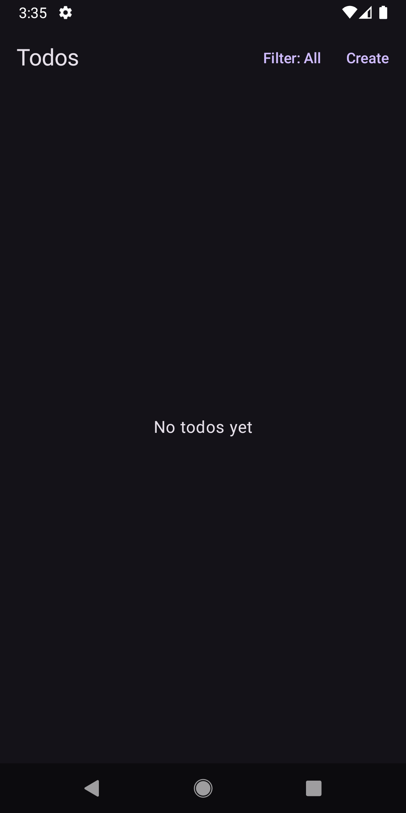
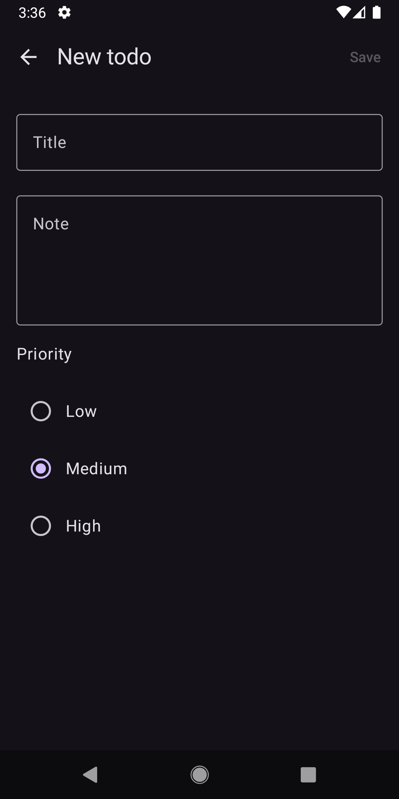
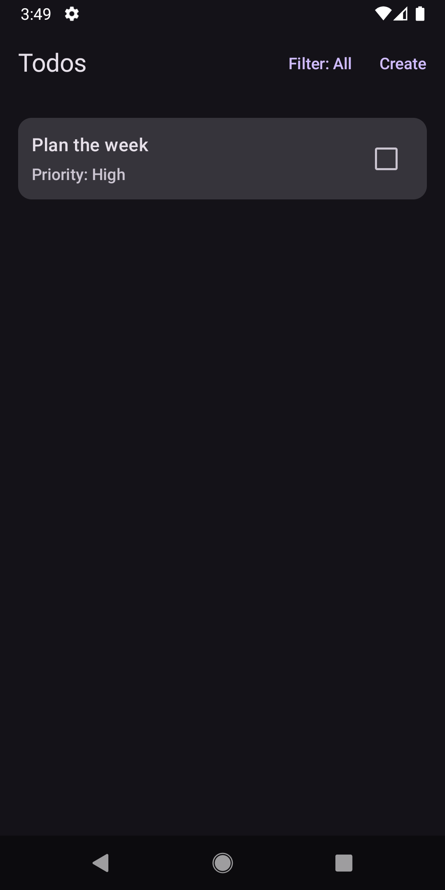
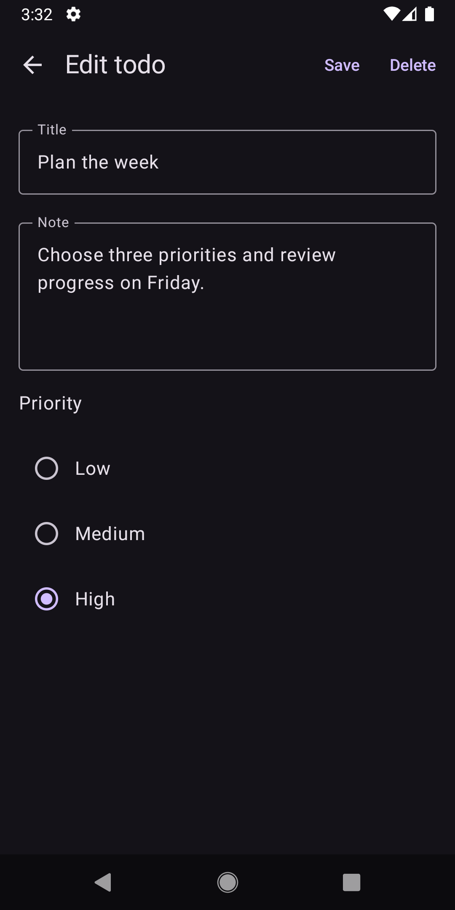

# Todo application

A two-screen Android app built with Kotlin, Jetpack Compose, and Material 3.
Create tasks, organize them by priority, and track completion.

  &nbsp;
  &nbsp;
  &nbsp;
  

Captured from the app on Pixel 3 / Android 11.

- Create, edit, delete, and complete todos; filter the list by priority.
- Recover from load/save failures with explicit retry and retained form input.
- Confirm before discarding unsaved changes and prevent duplicate submissions.
- Keep drafts and pending operations through Activity recreation.

The app uses MVI presentation state, destination-scoped ViewModels, and a
`presentation → domain ← data` dependency direction with manual constructor injection.
An in-memory fake server simulates latency and failures; tasks live for the current process.

Licensed under [Apache 2.0](LICENSE).
